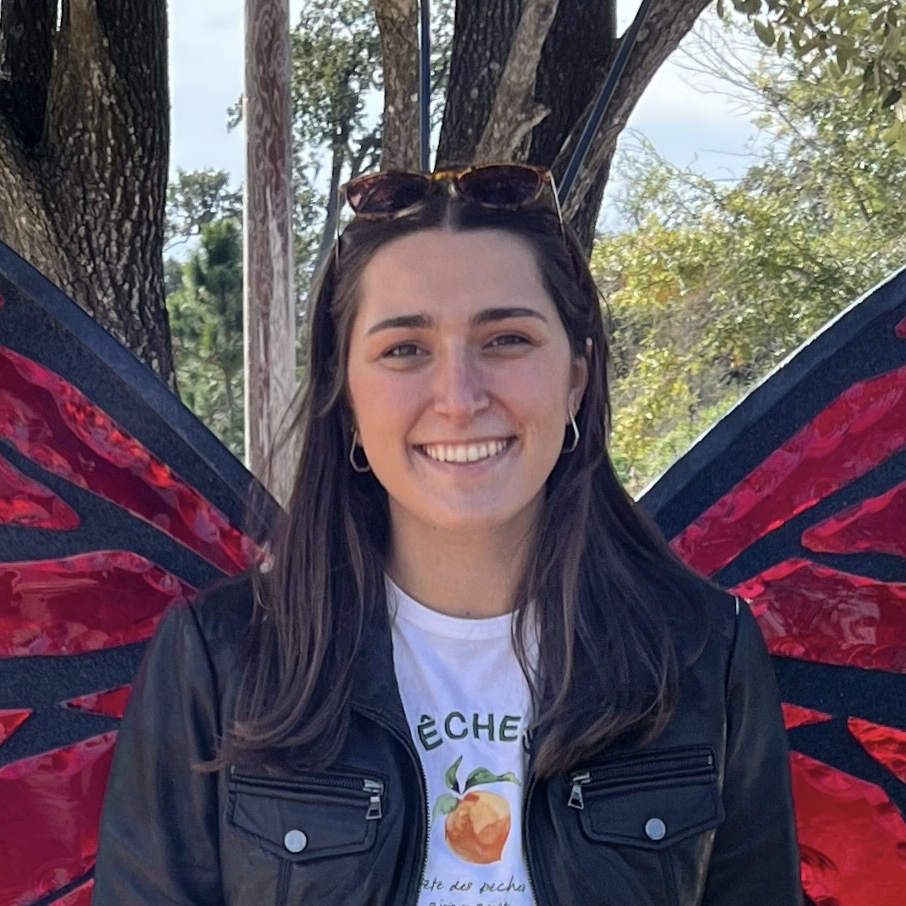

```{=html}
<div class="website-container">

  <div class="left-sidebar">
    
    <h3>Abigail Dittmar</h3>
    <p>PhD Candidate</p>
    <p>Underwood Inouye Lab</p>
    <p>Florida State University</p>
    <p><strong>Email:</strong> adittmar@fsu.edu</p>
    <p><a href="https://scholar.google.com/citations?user=gh0p3BMAAAAJ&hl=en&oi=ao"> Google Scholar</a></p>
    <p><a href="https://www.researchgate.net/profile/Abigail-Dittmar?ev=hdr_xprf"> ResearchGate</a></p>
  </div>

  <div class="main-content">
    <h1>About Me</h1>
    <p>I am a theoretical ecologist who is interested in the spatial and temporal dynamics of populations, with a focus on plant-insect interactions. I am particularly interested in...</p>
    <br>
    <p> I am a PhD candidate working with <a href="https://underwood-inouye-lab.weebly.com/"> Nora Underwood and Brian Inouye</a> at Florida State University. I completed my BA at Cornell University     working with <a href="https://blogs.cornell.edu/thaler/"> Jennifer Thaler</a>.
  </div>

</div>
```

